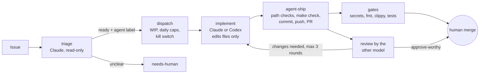

# Project Euler

Solutions to [Project Euler](https://projecteuler.net/) problems in Rust, from the N33L4M1N lab notebook.

Each problem lives in `src/pNNN.rs` with a short note on the approach and two tests: the worked example from the
problem statement (or a small hand-checked case), and the verified answer. Shared number theory (gcd, lcm, sieve,
divisor sums) and small big-number helpers are in `src/math.rs`.

```sh
cargo test                      # check every answer
cargo run --release             # solve everything, with timings
cargo run --release -- 7 10     # solve specific problems
```

Problems 1 and 2 were first solved in C in 2017. Those originals are kept in [`c/`](c/).

## How this repository is built: an agent loop with one human gate

Since problem 11, the solutions are written by AI agents in GitHub Actions, and a person only merges. The repository
is a small, real test of that workflow: every step is in [`.github/`](.github/), and every PR shows who did what.



| Step | Who | Where |
|---|---|---|
| Triage: ready or not, which agent, size | Claude (read-only tools) | [`triage.yml`](.github/workflows/triage.yml) |
| Dispatch, inside the brakes below | a shell script | [`dispatch.yml`](.github/workflows/dispatch.yml) |
| Implement | Claude or Codex, whichever triage picked | [`implement-claude.yml`](.github/workflows/implement-claude.yml), [`implement-codex.yml`](.github/workflows/implement-codex.yml) |
| Check, commit, push, open the PR | a shell script, as `n33l4m1n-agent[bot]` | [`agent-ship`](.github/actions/agent-ship/action.yml) |
| Review | the *other* model: Codex reviews Claude, Claude reviews Codex | [`review-codex.yml`](.github/workflows/review-codex.yml), [`review-claude.yml`](.github/workflows/review-claude.yml) |
| Required checks | gitleaks, `make check` | [`gates.yml`](.github/workflows/gates.yml) |
| Merge | the owner | GitHub, under a ruleset |
| Daily digest | a shell script | [`loop-health.yml`](.github/workflows/loop-health.yml), pinned "Loop health" issue |

The rules every agent works under are in [`CLAUDE.md`](CLAUDE.md).

### Guardrails

- **One human gate.** `main` takes changes only through a pull request with the code owner's approval after the
  last push and a green `gates` check, by squash merge. Agents can open PRs; they can't approve or merge them.
- **A scoped bot identity.** Agents push as a GitHub App, installed on selected repositories with contents,
  pull-request and issue access only, and **no workflow permission**, so it can't change CI. Each run gets a
  token for this one repository that expires within an hour.
- **Agents never hold the GitHub token.** The checkout keeps no credentials; the agent only edits the working tree,
  and a separate step commits and pushes. Changes to `.github/`, the `Makefile`, the toolchain pin or `Cargo.toml`
  are refused before anything is pushed.
- **Author ≠ reviewer.** A different model reviews every PR, with findings tagged BLOCKING, NIT or UNVERIFIED. Only a
  blocking finding sends the PR back, at most three times; after that a human decides.
- **Brakes.** A kill switch (`AGENTS_ENABLED`), at most two tasks in flight, a daily cap on implement runs and a
  lower one for the pay-per-use model. Failures, dead ends and PRs closed without merging land in `needs-human`.
- **Trusted input only.** Only issues from accounts with write access reach a model; anyone else's issue is
  labelled for a human and never shown to an agent. Issue and PR text is treated as data, not instructions.
- **Pinned supply chain.** Every third-party action is pinned to a commit, the Claude Code CLI to a version, the
  Rust toolchain to a release, and gitleaks to a checksum. The crate has no dependencies.

### The record so far

| PR | Problems | Implemented by | Reviewed by | Status |
|---|---|---|---|---|
| [#4](../../pull/4) | 11–15 | Claude | Codex | merged |
| [#7](../../pull/7) | 16–20 | Claude | Codex | merged |
| [#11](../../pull/11) | 21 | Codex | Claude | the first run from triage to PR with no human step, in about two minutes |

The owner reads each diff and its review before approving. One early review flagged a lint failure that the real
gate then disproved, which is why reviewers now leave tool results to `gates` and mark what they couldn't check as
unverified.

### Driving the loop

Open an issue with a clear task and testable acceptance criteria; triage takes it from there. To skip triage,
open it with the `ready` label and `agent:claude` or `agent:codex`.

## Licence and sources

Project Euler asks that solutions beyond the first 100 problems stay private, so this repository stops at
problem 100.

Problem statements are paraphrased from projecteuler.net, licensed
[CC BY-NC-SA 4.0](https://creativecommons.org/licenses/by-nc-sa/4.0/).
